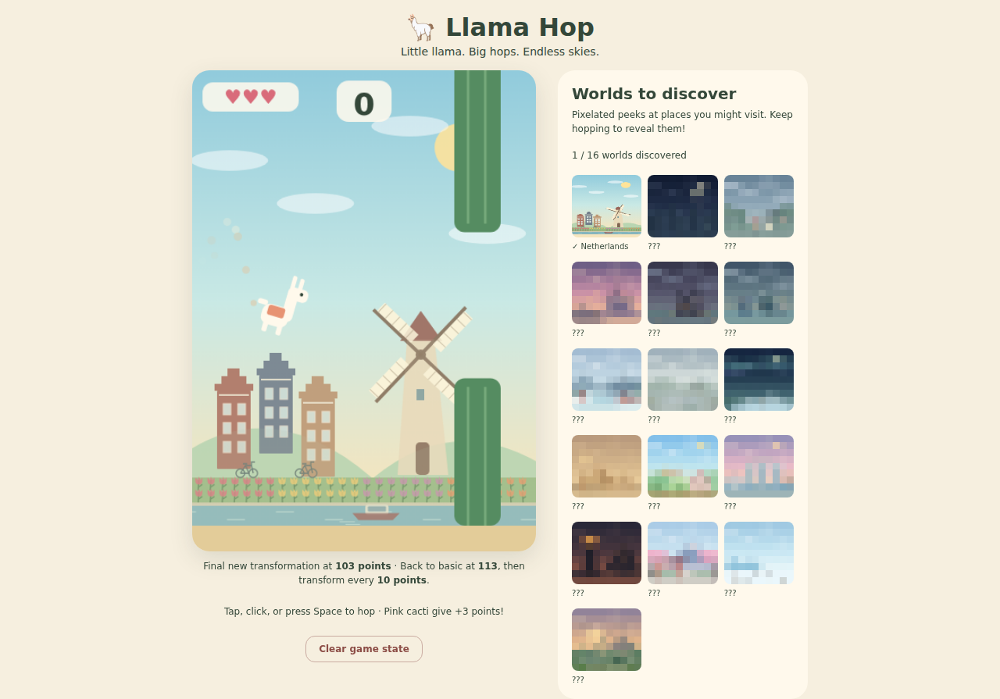

# Llama Hop

<p align="center">
  <a href="https://cardin.github.io/llama-hop/"><strong>▶ Play Llama Hop</strong></a>
</p>

<p align="center">
  <a href="https://cardin.github.io/llama-hop/">
    
  </a>
</p>

A desktop-friendly canvas game: hop through cactus gaps, discover new worlds,
and unlock pop-culture llama transformations. No build step or dependencies.

## Play locally

```sh
python3 -m http.server 8080 --bind 127.0.0.1
```

Open <http://localhost:8080>. Click or press Space / Arrow Up to hop.

- Pink cacti award 3 points; every 9 points earns an extra life.
- Transformations start at 13 points; the final new form unlocks at 103 points.
- At 113 points the basic llama returns, followed by Ash at 123, Super Saiyan
  at 133, and so on. Forms repeat every 10 points while the score keeps rising.
- Best score and discovered worlds are saved in browser local storage.
- **Clear game state** resets progress after confirmation.
- All scene and character animations are always enabled.

## Development

No build step: edit files under `js/` and reload the local server. Run
`npm test` with Node.js for the dependency-free test suite.

## Attribution

See `ASSETS.md` and the bundled font licenses for asset attribution; character
references belong to their respective rights holders.
